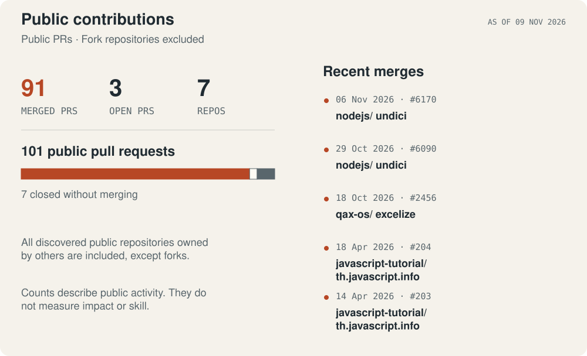
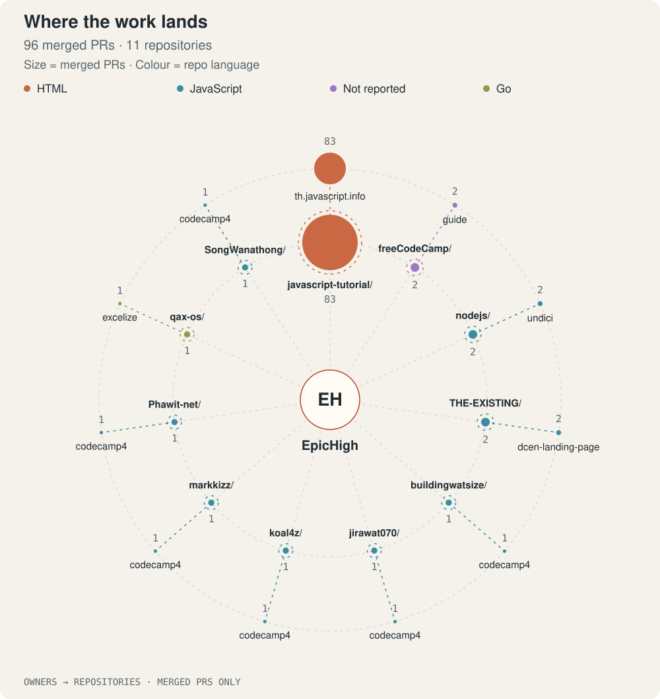
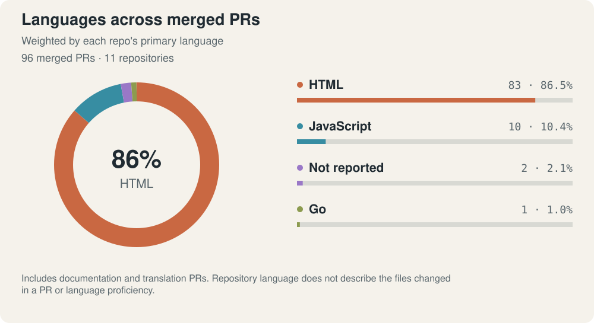

<picture>
  <source media="(max-width: 640px) and (prefers-color-scheme: dark)" srcset="assets/profile/hero-mobile-dark.svg">
  <source media="(max-width: 640px)" srcset="assets/profile/hero-mobile-light.svg">
  <source media="(prefers-color-scheme: dark)" srcset="assets/profile/hero-dark.svg">
  
</picture>

I'm **Prasit Tongpradit**, a software engineer at **PwC Thailand** in Bangkok. I work on **Tax Platform**, helping turn complex tax workflows into practical software for tax teams. I also build developer tools and contribute to open source.

**For full-time roles, freelance work, or consulting: [let's talk on LinkedIn ↗](https://www.linkedin.com/in/prasit-tongpradit/)**

[Explore my contributions](#selected-work) · [Public activity](#open-source-activity)

## Selected work

### 01 / Node.js · Undici

**HTTP/2 reliability · Two merged contributions**

Fixed connection-pool scheduling so a long-lived HTTP/2 stream does not leave other requests stuck when another connection is allowed. A second fix preserves responses already accepted by the server when stream IDs arrive late. Both changes include regression tests.

**[Pool scheduling fix →](https://github.com/nodejs/undici/pull/6170)** · [Stream lifecycle fix](https://github.com/nodejs/undici/pull/6090)

### 02 / Excelize

**Go · Merged contribution**

Prevented panics when spreadsheet formulas access invalid ranges. Five conditional aggregation functions now return `#VALUE!` for those invalid accesses. The change includes regression coverage for the affected cases.

**[Read the merged pull request →](https://github.com/qax-os/excelize/pull/2456)**

## Open-source activity

Public pull requests I authored in repositories owned by other people or organizations. **Fork repositories are excluded**; archived projects are included. Merged, open, and closed PRs are counted separately.

<a href="PUBLIC_ACTIVITY.md">
  <picture>
    <source media="(max-width: 640px) and (prefers-color-scheme: dark)" srcset="assets/profile/activity-mobile-dark.svg">
    <source media="(max-width: 640px)" srcset="assets/profile/activity-mobile-light.svg">
    <source media="(prefers-color-scheme: dark)" srcset="assets/profile/activity-dark.svg">
    
  </picture>
</a>

<a href="PUBLIC_ACTIVITY.md">
  <picture>
    <source media="(max-width: 640px) and (prefers-color-scheme: dark)" srcset="assets/profile/activity-network-mobile-dark.svg">
    <source media="(max-width: 640px)" srcset="assets/profile/activity-network-mobile-light.svg">
    <source media="(prefers-color-scheme: dark)" srcset="assets/profile/activity-network-dark.svg">
    
  </picture>
</a>

<a href="PUBLIC_ACTIVITY.md">
  <picture>
    <source media="(max-width: 640px) and (prefers-color-scheme: dark)" srcset="assets/profile/activity-languages-mobile-dark.svg">
    <source media="(max-width: 640px)" srcset="assets/profile/activity-languages-mobile-light.svg">
    <source media="(prefers-color-scheme: dark)" srcset="assets/profile/activity-languages-dark.svg">
    
  </picture>
</a>

Both charts use **merged PRs**. The donut includes only programming languages, as classified by GitHub Linguist, and calculates percentages within that subset. It follows each repository's primary language, not language proficiency.

[View counts, dates, and every pull request →](PUBLIC_ACTIVITY.md) · Updated daily from public data.

## What I bring to a team

- **Product thinking across the stack.** Connecting business rules, usable interfaces, service APIs, and data workflows with TypeScript, Go, and Python.
- **Practical automation.** Working with document extraction, search, and AI-assisted knowledge tools grounded in source documents.
- **Care for the next maintainer.** Simple architecture, clear contracts, automated checks, accessible interfaces, and documentation people can follow.

## Tools I work with

- **Languages:** TypeScript, JavaScript, Go, Python, SQL
- **Web:** React, Next.js, React Router, Svelte, Node.js
- **Platform & data:** Azure, Docker, Nx, GitHub Actions, SQL Server, MongoDB

## Let's build something useful

Working on a complex business product, a document workflow, or tools for developers? Tell me about the role or project, the problem you're solving, and your timeline.

**[Start a conversation on LinkedIn →](https://www.linkedin.com/in/prasit-tongpradit/)**

Bangkok, Thailand · UTC+7
